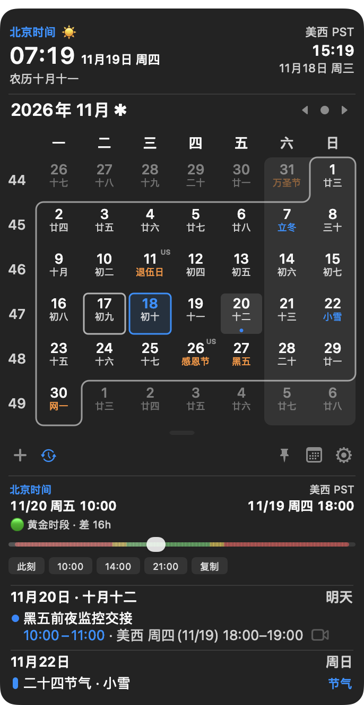
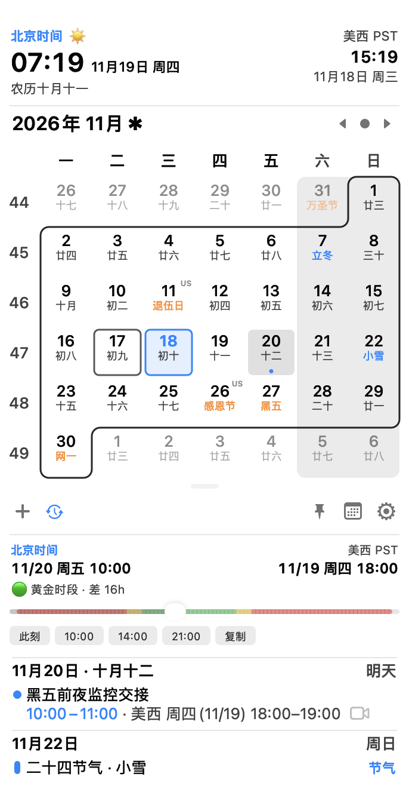
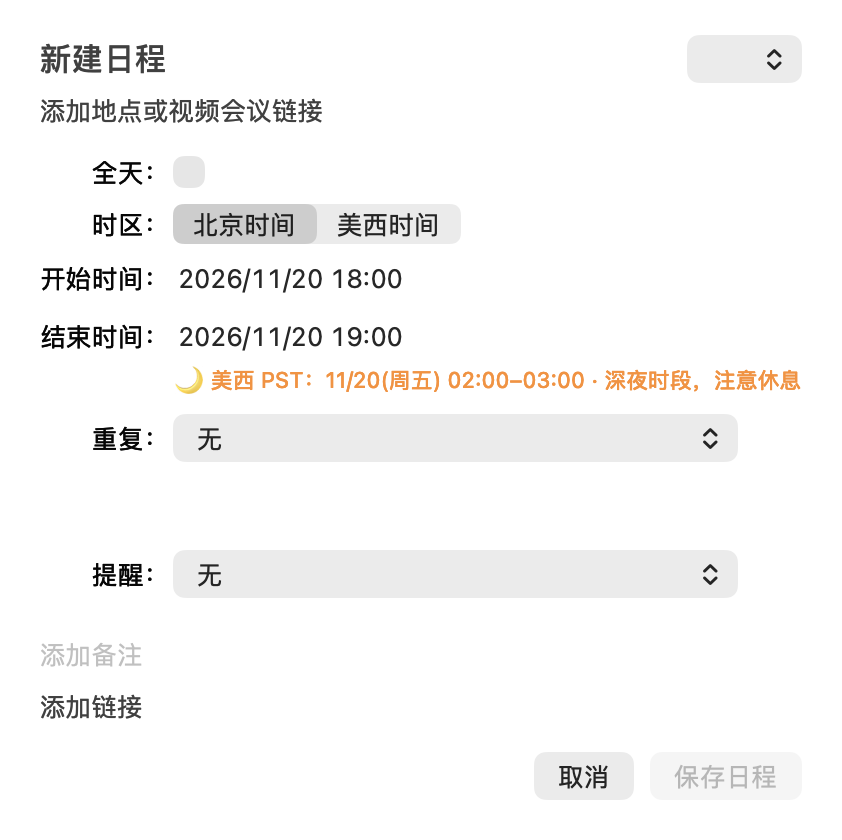

# Itsycal DualTZ — 专为美区 Mac（Claude/AI 用户）与跨境电商打造的双时区菜单栏日历

[English](./README_EN.md) | 简体中文 · [直接下载安装包 (.dmg)](https://github.com/GangdanLee/Itsycal-DualTZ/releases/latest/download/Itsycal-DualTZ-v2.2.4-macOS-arm64.dmg) · [Releases 列表](https://github.com/GangdanLee/Itsycal-DualTZ/releases) · [问题反馈](https://github.com/GangdanLee/Itsycal-DualTZ/issues)

[](https://github.com/GangdanLee/Itsycal-DualTZ/releases)
[](https://github.com/GangdanLee/Itsycal-DualTZ/releases/latest)
[](./LICENSE.txt)
[](./README_EN.md)

> **Mac 系统为了用 Claude / AI 把地区和时区锁定在美区（PST/PDT），但自己人在国内、团队按北京时间协作、同时又在做北美跨境电商（Amazon / TikTok Shop / Temu / 独立站）？**
>
> **Itsycal DualTZ v2.0** 采用原生 macOS `NSGlassEffectView` **无尖角悬浮液态玻璃**重构主面板与设置中心，在不改动任何系统美区设置的前提下，把**菜单栏时钟、世界时钟 Bento 工作台、月历网格、今日选中与新建日程**全面默认切回自定义主城时区（默认**北京时间 CST**），同时在 2 列玻璃子卡中实时显示**美西 / 美东动态夏冬令时、当地工作态势与中美节假日/黑五网一节点**。

---

## 一键下载与安装

> **适用人群**：因使用 Claude Desktop / Claude Code / 美区开发者服务而将 macOS 设为美国地区或美西时区，同时需要按中国北京时间生活办公、或运营北美跨境电商的 Mac 用户。

| 安装包类型 | 文件名 | 适用架构与说明 | 直接下载 |
| :--- | :--- | :--- | :--- |
| **DMG 安装镜像（推荐）** | `Itsycal-DualTZ-v2.2.4-macOS-arm64.dmg` | Apple Silicon (`arm64`)，含 `/Applications` 拖放快捷方式与首次打开说明 | [点击下载 DMG](https://github.com/GangdanLee/Itsycal-DualTZ/releases/latest/download/Itsycal-DualTZ-v2.2.4-macOS-arm64.dmg) |
| **ZIP 免挂载压缩包** | `Itsycal-DualTZ-v2.2.4-macOS-arm64.zip` | 解压即得 `Itsycal DualTZ.app`，拖入「应用程序」即可 | [点击下载 ZIP](https://github.com/GangdanLee/Itsycal-DualTZ/releases/latest/download/Itsycal-DualTZ-v2.2.4-macOS-arm64.zip) |
| **SHA256 校验文件** | `SHA256SUMS.txt` | 安装包完整性校验 | [查看校验值](https://github.com/GangdanLee/Itsycal-DualTZ/releases/latest/download/SHA256SUMS.txt) |

---

## v2.2.4 免密自动同步与零密码打扰升级

- **打开菜单栏绝不再弹系统密码框**：点开日历与自动刷新全程不再触发敏感凭据验证；即使正在切换账号或尚未开启免密同步，也会平滑展示上次已知额度并静默完成更新，彻底告别高频验证弹窗。
- **一键开启「Claude 免密自动同步」**：利用 Claude Code 原生回调能力直接获取最新 `5h / 7d` 剩余额度，无需安装第三方工具或任何外部依赖；对本机已有多个 Claude 账号或自定义终端配置的用户自动无损并存、不破坏原有显示。
- **日常体验与通用打包优化**：全面改写设置中心与状态栏的授权及同步提示文案，告别晦涩技术术语，一眼看懂当前同步状态；分发应用全面统一标准通用签名构建，配合全新首次打开指引开箱即用。

## v2.2.3 交互与额度池精修：收起态微环、零跳顶设置中心与全平台双窗对齐

- **主弹窗收起态底部栏精修**：收起态专注以单行 5 枚均分圆环铺满展示全部已启用 AI 账号实时用量，与右侧展开/刷新操作区严格对齐、不撑宽弹窗（未启用任何 AI 账号时自动兜底展示订阅微环）。
- **设置中心全 6 Tab 滚动保持与表单可视微调**：修复同页内点击编辑、开关、积木或异步刷新回调强制跳回顶部的问题；展开位于底部的内联编辑表单或高级自定义格式代码时自动微调露出「保存更新」与输入框；AI / 订阅编辑态互斥且单条刷新保留未保存输入。
- **全平台同池双窗统一 `min(5h, 7d)` 口径**：覆盖 Claude、Antigravity (Gemini) 与双窗 Codex，统一按短/长双窗口较低剩余量计算展示百分比、告警色与主导重置时间；Antigravity `3P` 同步取较低窗口并将标签精简为 `5h`/`7d` 消除展开卡片截断，去掉在线态误导的「离线缓存」提示。
- **Claude 真实用户名识别 + 同号提醒 + 口径透明**：只读请求官方 `/api/oauth/profile` 回填用户名（如 `display_name`）与邮箱；自动检测多个条目是否绑定同一 Claude 账号并在设置页亮出 `同号` 警告胶囊与详情条提醒；全界面明确标明「剩余额度」及主城重置时区。
- **Keychain 授权完自动回前台**：交互式读取 Keychain 输入密码或刷新结束后，若设置窗口仍处于开启状态，自动将其重新激活置顶，解决输完密码被其他应用遮挡的问题。

## v2.2.2 防关联升级：Claude 8h 休眠同步 & 按需安全唤醒

- **零关联识别 Claude 8h 休眠与真过期**：同步核查 Keychain 中 `refreshToken` / `refreshTokenExpiresAt` 有效期；8 小时 `accessToken` 休眠但长期登录态仍有效时不再误报“登录已过期 · 请重新登录”，自动转入本地 `.claude.json`（`cachedUsageUtilization`）只读缓存兜底，并展示 **`休眠中 · 点单条 ↻ 唤醒或使用即同步`**。
- **防同 IP 多号心跳 & 单条按需安全唤醒**：启用多个 Claude 账号时，后台自动刷新与「立即刷新全部」禁止并发唤醒休眠号（活跃多号之间带 `250–600ms` 串行抖动）；在设置页 Tab 5 为每行新增独立 **`↻` 单条刷新按钮**，仅当你主动点击对应行时才通过其隔离目录委托 `claude doctor` 原生安全唤醒该单一账号。
- **隔离目录自动反查 & 防空目录重建**：支持按 SHA-256 哈希自动反查 `~/.claude-*` 及现有 Orca 隔离目录（完全无第三方强绑定，未安装或后续卸载均可独立配置）；校验目标目录真实存在后才执行 CLI 唤醒，杜绝已删除路径重建空目录；完善 `5h` 满额（`resetsAt == nil`）回退展示 `7d` 重置时间。

## v2.2.1 体验与采集引擎全面修复

- **主弹窗动态自适应高度**：修复展开底部多账号圆环/订阅总览时窗口高度固定导致顶部世界时钟与前半月历被截断的问题；点击主城区块即可整区折叠/展开副城卡片，支持 `⌘N` / `⌘,` 快捷键，并优化浅色议程分组头白条与月历事件橙点间距。
- **全平台 AI 额度稳定采集 & Keychain 零闪退**：
  - 修复 Keychain 授权或后台线程回写导致的 KVO 闪退，后台刷新纯静默不弹窗，交互授权按需串行执行；
  - 适配新版 **Antigravity** (`agy -p /usage --output-format json`) 实时获取 Gemini 与 3P 双窗额度，并在离线时保留最后真实百分比；
  - 实现 **Cursor** Safe Storage (`AES-128-CBC` + `PBKDF2-SHA1`) 本地凭据解密与 **Claude Code** OAuth 过期交互续期（`claude auth status`）。
- **圆环底栏 & 设置中心打磨**：2 列展开卡片严格 50/50 对齐、折叠行优先展示有效有数据账号并自适应 3 位数圆环字号；设置中心支持上下缩放（默认 `650pt`）、动态同步版本标识、每 15 秒实时同步菜单栏预览时钟。

## v2.2.0 新增：多账号 AI 额度池 & 统一圆环底栏（零风控只读）

- **零第三方依赖原生采集引擎（参考 MIT 协议 `steipete/CodexBar`）**：无需安装外部 CLI，不拉取多余包依赖，直接原生支持 **双/多 Claude Code 账号（自动发现所有 `Claude Code-credentials*` Keychain 条目与 `CLAUDE_CONFIG_DIR` 隔离）**、**Antigravity (Gemini)**、**ChatGPT Codex** 与 **Cursor**。
- **Antigravity 离线免重登缓存**：通过本地 Language Server RPC 探针（`https://127.0.0.1` 专属自签信任代理）采集 Gemini 与 Claude/GPT 池额度；关闭 Antigravity 后自动保留上次真实百分比与重置时间并标记为 `离线缓存`（周期过期不造假 100%）。
- **5 项安全与零风控铁律**：
  1. 弹窗开启节流（300 秒最小自动刷新间隔）与 HTTP `429` 账号级冷却退避；
  2. 后台 Keychain 查询附带 `kSecUseAuthenticationUIFail`，永不弹出烦人解锁框；
  3. 全链路**只读不覆写**外部 `.credentials.json` / `auth.json` / `state.vscdb` 或 Keychain，不破坏 Claude/Codex/Antigravity/Cursor 登录态；
  4. **绝不抓取浏览器 Cookie**（Cursor 仅通过系统 `SQLite3` 只读本地客户端库）；
  5. `UserDefaults` 与日志**绝不落盘任何 Token / Cookie / Secret**。
- **主面板统一圆环工作条 & Tab 5 额度池管理**：折叠态紧凑双微环（内嵌剩余整数）+ 一键刷新按钮，展开态 2 列卡片汇总 AI 额度与订阅倒计时，支持自定义每个账号名称。

## v2.1.0 核心能力：纯离线海外订阅扣费账本与进度圆环

- **纯离线零风控账本（`SubscriptionStore`）**：专为 Claude / ChatGPT / Cursor / Amazon 卖家月租等海外按月订阅打造，本地记录**自定义订阅名称、账号邮箱、区域（美区/日区/英区/欧区/新加坡/国区）、支付卡尾号与账单时区**，不接触任何账号 Cookie 或外部网络请求。
- **闰年 / 大小月 & 夏冬令时自动对齐**：自动按目标计费时区（如美西 PST/PDT）夹取 29–31 号跨月扣费日期并换算为北京时间精确扣费时刻。
- **主面板底部订阅圆环条（`SubscriptionBarView`）**：
  - **折叠态（默认）**：紧凑双微环（`CAShapeLayer` 倒计时圆环 + 剩余天数），不挤压上方日历与日程空间；
  - **展开态（一键切换）**：2 列卡片网格展示全部启用订阅，点击单卡通过渐进披露条查看区域、付款卡与北京时间精确扣费时刻。
- **月历扣费日橙点 & 虚拟议程条**：订阅扣费当天的北京日历格自动点亮 **橙色提示圆点**，点击当天即可在底部议程列表查看对应 `扣费` 提醒与付款账号信息。
- **设置页「额度与订阅」完整账本**：Tab 5 原生支持 `+ 添加订阅`、2 列 6 格内联编辑表单、开关与删除，并为主面板底部展示提供 **关闭 / 紧凑圆环 / 展开卡片** 一键切换。

## v2.0.0 核心架构特性

- **无尖角悬浮液态玻璃（3 档材质可选）**：基于原生 macOS `NSGlassEffectView` 提供 **液态标准 / 液态通透 / 经典高对比磨砂** 切换，配合透明底色日历/日程层与无常驻滚动条交互，彻底摆脱传统尖角实色弹窗。
- **顶部世界时钟 Bento Hero 工作台**：支持自定义主城基准时区与显示别名（如「北京」「深圳总部」），下方可折叠 2 列副城玻璃卡片基于 IANA 时区自动切换 `PST/PDT`、`EST/EDT` 并实时标注 **办公中 / 消费高峰 / 早间 / 🌙 深夜** 工作态势。
- **保留经典 Itsycal 灵魂**：默认保留左侧 **ISO-8601 周数** 与柔光当月连续轮廓线，底部工具栏升级为 4 枚原生 SF Symbols 图标（`+` / `pin` / `calendar` / `gearshape`）。
- **全新原生 6-Tab System Settings 设置中心**：毛玻璃侧边栏渐变 Squircle 徽标 + 可视化菜单栏积木拼接器（实时评估 MacBook 刘海宽度）+ 副城实时搜索与别名定制 + EventKit 日历源直接开关。

---

## 为什么做这个工具？（痛点对比）

很多 AI 开发者、独立开发与跨境运营都会遇到同一个割裂场景：**为了稳定使用 Claude 等海外 AI 服务与美区生态，Mac 系统时区长期放在 `America/Los_Angeles`（美西 PST/PDT）**；但自己的作息、国内团队沟通、银行卡账单和日常记事全是**北京时间（UTC+8）**，而美国店铺活动、物流和美方客户对接又要看**美西/美东时间**。

| 日常痛点场景 | 原版美区系统日历体验 | **Itsycal DualTZ 解决方案** |
| :--- | :--- | :--- |
| **美西下午 / 北京上午时间错位** | 菜单栏与系统日历全显示昨天，频繁算错「今天到底是几号」 | 顶部 **北京时间 Hero 视觉中心**（日夜图标 + 北京时分秒 + 星期 + 农历），菜单栏图标默认显示**北京日期** |
| **记日程默认走美西时区** | 随手建个明天 10:00 的国内会，实际记成美西 10:00（北京凌晨 02:00） | 新建日程 **默认选中「北京时间」**，24 小时制无 AM/PM 歧义；若折算美方时间落入 `00:00–06:59` 自动触发 **橙色 `🌙` 深夜预警** |
| **全天日程跨 16 小时串天** | 美西零点建的纪念日/促销全天日程，换算成北京时区后跨成两天 | `EventCenter` 与详情气泡对 **全天日程按浮动日历日期精确对齐单日**，彻底告别全天日程串天 |
| **中美节假日与跨境营销节点割裂** | 系统日历只有美国假日，没有国内调休/补班/农历节气，也没有 618/黑五/网一 | 内置 **中国国务院放假调休 (`休`/`班`) + 农历与 24 节气 + 美国 11 项联邦假日 (`US`) + 黑五/网一/618/双11 跨境营销节点**，可按需独立开关 |
| **跨国排会反复心算夏/冬令时** | 美西与北京冬令时差 `16h`、夏令时差 `15h`，换算极易出错 | 一键展开 **96 槽位双时区排会时间轴**（标出绿区黄金协同窗），并提前 7 天预警美国夏/冬令时切换 |
| **发会议邀约手动拼双时区** | 复制会议通知要手动算两个时区，原版不识别飞书与腾讯会议 | 右键日程支持 **「复制双时区邀约」**，同时输出北京+美西时间；内置识别 **飞书 / Lark / 腾讯会议 / Zoom / Teams / Google Meet**，会前 **15 分钟菜单栏轻量倒计时** |
| **原版 Itsycal 用户迁移成本** | 怕破坏原有简洁习惯，担心冲突 | 使用独立 Bundle ID `com.morgan.ItsycalDualTZ`，**可与原版 `Itsycal.app` 同时并排运行**，首次启动自动导入你的字号、日历源与外观偏好 |

---

## 界面展示与核心功能

<table>
  <tr>
    <td align="center"><b>暗色模式主面板（北京主日历 + 排会时间轴 + 双时区日程）</b></td>
    <td align="center"><b>浅色模式主面板（双今标 + 中美节假日 + 跨境节点）</b></td>
  </tr>
  <tr>
    <td align="center"></td>
    <td align="center"></td>
  </tr>
  <tr>
    <td align="center"><b>新建日程（默认北京时间 + 24h制 + 🌙 凌晨橙色预警）</b></td>
    <td align="center"><b>双时区模块化开关（中英文实时热切换，无需重启）</b></td>
  </tr>
  <tr>
    <td align="center"></td>
    <td align="center"></td>
  </tr>
</table>

### 1. 北京时间为主、美西为辅的视觉与数据架构
- **菜单栏自定义双时区模板**：支持 `{BJ:...}`（北京）、`{NY:...}`（美东）、`{UTC:...}`、`{diff}`（时差与跨天 `+1d`）、`{bj_dn}`（太阳/月亮日夜图标）等占位符，开箱即用「极简北京 / 日夜图标 / 带月日 / 双时区」4 套一键预设。
- **双今日三态网格**：系统处于美西昨日、北京进入次日时，月历上同时标出 **北京今日（实心蓝框 + 浅蓝底）** 与 **美西今日（低调灰框）**；「回到今天」按钮与点击默认日均优先定位**北京今日**。
- **底部双时区日程列表**：带时间的海外会议自动展示 **北京时间（蓝字主时间）· 美西时间（灰字参考）**，非海外大事件与选中日期即使当日无日程，也支持内联展示节日摘要与农历信息（纯内置节日不会污染月历圆点）。

### 2. 专为中国本土化 + 北美跨境电商优化的日历生态
- **中国法定假日与调休（内置 + 可更新）**：自带 2025–2027 年中国国务院放假与周末补班数据（`休` 绿色 / `班` 橙色角标），支持设置页内 **在线一键同步最新国务院调休** 或导入自定义 JSON。
- **美国联邦假日 & 跨境营销节点解耦**：
  - 联邦与银行物流大节点（马丁路德金日、总统日、阵亡将士纪念日、独立日、劳动节、哥伦布日、退伍军人日、感恩节、`Black Friday 黑五`、`Cyber Monday 网一` 等）；
  - 跨境营销大促开关（情人节、母亲节、父亲节、`618`、万圣节、`双 11`、平安夜）。不常用可随时在「设置 → 双时区」关闭。
- **国产 + 海外主流会议工具识别 & 会前提醒**：除原版 Zoom / Teams / Google Meet 外，新增识别 **飞书（`vc.feishu.cn` / `feishu.cn/j/`）、Lark（`larksuite.com`）与腾讯会议（`meeting.tencent.com` / `wemeet.tencent.com`）**；会议开始前 15 分钟在菜单栏末尾显示轻量 `· 10m后开会`。

### 3. 设置直达与双语热切换
- **中英文实时热切换**：在「设置 → 通用 → 界面语言」可在 **简体中文 / English / 跟随系统** 之间免重启实时热切换（全界面包括菜单、月历标题、新建日程、5 个设置标签页统一生效）。
- **无痛引导**：启用双时区菜单栏模板后，外观页原版日期模板框自动禁用并给出橙色提示（避免双配置混淆）；若尚未授予系统日历权限，可直接点击按钮一键打开 macOS「隐私与安全性 → 日历」。

---

## 安装与首次打开

1. 从 [Releases 页面](https://github.com/GangdanLee/Itsycal-DualTZ/releases/latest) 下载 **`Itsycal-DualTZ-v2.2.4-macOS-arm64.dmg`**（推荐）或 `.zip`。
2. 双击 `.dmg`，将 **`Itsycal DualTZ.app`** 拖入右侧的 **`Applications`**（应用程序）文件夹。
3. **首次打开防拦截提示**：由于本应用使用个人本地自签名（未购买 Apple 付费 Developer ID 公证），首次双击若系统提示*“已损坏，无法打开”*或*“无法验证开发者”*，请在「终端 (Terminal)」执行一次下方命令移除下载隔离属性，然后正常双击打开即可：

```bash
xattr -cr "/Applications/Itsycal DualTZ.app"
```

4. 弹窗后在右下角齿轮或 `⌘,` 打开全新 6-Tab 设置中心：
   - 在 **通用与菜单栏** 切换三档液态玻璃材质并用可视化积木组合顶栏显示元素；
   - 在 **世界时钟** 自定义主城基准与别名、搜索并管理美国业务城市；
   - 在 **日程与提醒** 授予日历权限并勾选需要显示的 iCloud / Google / 本地日历。

> **系统要求**：macOS 27.0+，Apple Silicon (`arm64`)（基于上游 `sfsam/Itsycal 0.29.0` 架构）。如需支持更低版本 macOS 或 Intel 芯片，可克隆仓库自行调整 Xcode Deployment Target 编译。

---

## 从源码构建

```bash
git clone https://github.com/GangdanLee/Itsycal-DualTZ.git
cd Itsycal-DualTZ
cp Local.xcconfig.example Local.xcconfig
xcodebuild -project Itsycal.xcodeproj -scheme Itsycal -configuration Release -derivedDataPath build_derived build
```

构建产物位于 `build_derived/Build/Products/Release/Itsycal.app`。工程架构与定制细节请参阅 [docs/ARCHITECTURE.md](./docs/ARCHITECTURE.md) 与 [docs/ROADMAP.md](./docs/ROADMAP.md)。

---

## 常见问题（FAQ）

**Q：我为了用 Claude 把 macOS 系统时区锁在了美西（Los Angeles），不改系统时区能正常用吗？**  
A：完全可以，这正是本工具的核心使用场景。你不需要改动任何 macOS 系统时区、语言或地区设置，Itsycal DualTZ 会在应用内部以北京时间为第一主视角展示菜单栏日期、月历网格、默认新建日程和底部议程。

**Q：之前用原版 Itsycal，装这个会覆盖原来的配置吗？**  
A：不会。Itsycal DualTZ 使用独立 Bundle ID（`com.morgan.ItsycalDualTZ`），可与原版 `Itsycal.app` 同时运行；仅首次启动时会只读导入原版的字号、高亮、周起始日与已选日历列表，之后所有双时区与本地化配置完全独立保存。

**Q：全天日程（如生日、店庆、美国假期）会因为 16 小时时差跨成两天吗？**  
A：不会。我们在 `EventCenter` 分桶层与详情弹窗中专门处理了 EventKit 全天日程的浮动公历日期与独家午夜边界，保证单日全天日程在北京主日历中严丝合缝地只显示在对应日期当格。

**Q：美国夏令时（UTC-7，差 15 小时）和冬令时（UTC-8，差 16 小时）会自动适配吗？**  
A：是的，基于标准 IANA 时区规则实时换算，无需手动调节；开启夏/冬令时提醒后，还会在切换前 7 天于面板顶部展示提醒横幅。

---

## 开源致谢与协议

- 本项目基于 [Sanjay Madan](https://github.com/sfsam) 开发的优秀开源菜单栏日历 **[sfsam/Itsycal](https://github.com/sfsam/Itsycal)**（`v0.29.0`）深度定制与扩展，衷心感谢原作者的无私开源。
- 多账号 AI 额度采集协议设计参考了 **[steipete/CodexBar](https://github.com/steipete/CodexBar)**（MIT License），在此一并致谢。
- 遵循 **MIT License** 开源协议发布，详情见 [LICENSE.txt](./LICENSE.txt)。
- 欢迎点亮右上角 ⭐ **Star**，或在 [Issues](https://github.com/GangdanLee/Itsycal-DualTZ/issues) 提交你的跨境运营/跨时区场景建议！
