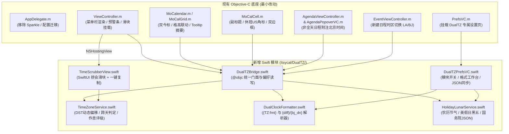

# 技术架构与改造设计文档：Itsycal DualTZ

- **文档版本**：v1.0
- **代码仓库**：`https://github.com/GangdanLee/Itsycal-DualTZ`
- **基线版本**：`sfsam/Itsycal` `0.29.0`（commit `287576c`）

---

## 1. 基线编译验证记录

在启动任何代码修改前，已对原始克隆工程进行本地只读基线编译验证，实测结果如下：

- **构建环境**：macOS `27.0` (`26A428`) / `Xcode 27.2` (`27B52`) / `MACOSX_DEPLOYMENT_TARGET = 27.0`
- **签名配置**：通过 `cp Local.xcconfig.example Local.xcconfig` 启用本地临时签名（`CODE_SIGN_IDENTITY = -`、`CODE_SIGN_STYLE = Automatic`、`ENABLE_HARDENED_RUNTIME = NO`），且 `.gitignore` 已自动忽略 `Local.xcconfig`。
- **执行命令**：
  ```bash
  xcodebuild -project Itsycal.xcodeproj -scheme Itsycal -configuration Debug -derivedDataPath build/DerivedData build
  ```
- **实测结果**：`** BUILD SUCCEEDED **`（零错误，真实耗时 `9.25s`，产出可执行二进制大小 `878K`）。
- **结论**：当前本机 Xcode 工具链可零障碍直接编译原版工程，具备以“Objective-C 最小侵入 + Swift 新增独立模块”混编推进改造的基础。

---

## 2. 总体架构：ObjC 底座 + Swift 模块化插件架构

### 2.1 架构原则
原版 `Itsycal` 为纯 Objective-C 编写，核心仅 52 个文件，AppKit 窗口管理、多显示器弹窗定位、`EventKit` 增量缓存（`EventCenter`）及快捷键集成（`MASShortcut`）极其成熟。为兼顾**开发效率、代码可维护性与改动安全边界**，采用混合架构：

1. **现有 Objective-C 底座保持“最小化钩子侵入”**：仅在必要的展示/输入节点注入数据调用与视图挂载点，不推翻原有窗口、事件缓存与键盘导航机制。
2. **所有新增业务与 UI 全部以独立 Swift 模块实现**：新建 `Itsycal/DualTZ/` 目录，利用 Swift 原生 `TimeZone`、`Calendar(identifier: .chinese)`、`Codable` 与 `SwiftUI`（通过 `NSHostingView` 嵌入 AppKit 视图树）完成所有双时区、农历节假日、时间轴滑块与专属设置页开发。
3. **单一职责与文件规模约束**：每个 Swift 文件严格控制在 300 行以内，状态与模型优先使用不可变 `struct`，通过 `@objc` 桥接类暴露给 ObjC 调用层。

### 2.2 模块交互与数据流图



---

## 3. 原版代码精确修改映射表

| 原版文件 | 关键源码位置 | 改造内容说明 |
| :--- | :--- | :--- |
| `Itsycal/Info.plist` | `CFBundleIdentifier`, `SUFeedURL`, `SUPublicEDKey` | 改为独立 Bundle ID（`$(PRODUCT_BUNDLE_IDENTIFIER)` 在 `pbxproj` 设为 `com.morgan.ItsycalDualTZ`）；移除 `SUFeedURL` 与 `SUPublicEDKey`；更新应用展示名为 `Itsycal DualTZ`。 |
| `Itsycal/AppDelegate.m` | `-applicationWillFinishLaunching:` (L87-93) | 移除 `[SUUpdater sharedUpdater]` 防止触发官方 Sparkle 更新；新增首次启动一次性检查并安全导入原版 `com.mowglii.ItsycalApp.plist` 偏好设置。 |
| `Itsycal/Itsycal.h/.m` | NSUserDefaults Keys (L13-44) | 声明所有 DualTZ 新增偏好 Key（含模块开关、自定义菜单栏格式模板、图标日归属、DST 忽略周期记录等）。 |
| `Itsycal/ViewController.m` | `-iconText` (L646-693)<br>`-updateMenubarIcon` (L695)<br>`-loadView` (L106) | 1. 在菜单栏时钟文本渲染分支接入 `DualClockFormatter`；<br>2. 图标数字默认跟随北京当前日期（支持切换回 LA 日期）；<br>3. 在主弹窗最顶部挂载 `BeijingHeroHeaderView`（`NSHostingView`，大字号展示北京时间与跨天标识）及条件式 DST 预警细条，工具栏新增排会换算展开控制。 |
| `Itsycal/Sizer.h/.m` | `-cellSize` (L50-52)<br>`-cellTextFieldVerticalSpace` (L54-56) | 增加 `320pt` 黄金弹窗宽度对应的动态单元格宽高计算（详见第 4 节防重叠公式）。 |
| `Itsycal/MoCode/MoCalendar/MoCalCell.h/.m` | `-init`, `-drawRect:` | 新增属性 `isBeijingToday`、`subLabelText`、`cornerBadgeText`、`cornerBadgeStyle`、`isHolidayStyle`；采用 Apple 原生日历无底色微字渲染右上角 `休/班/US`；双今标不显示格内“京/LA”文字，以主题蓝框+淡蓝底（北京今日）vs 前景细框（美西今日）vs 无边框实心底色（点选日）三态纯视觉区隔。 |
| `Itsycal/MoCode/MoCalendar/MoCalendar.m` | `-reloadData`, `-updateCells`, `-showDateInfo` | 填充单元格时向 `DualTZBridge` 查询双今标状态与当日农历/节假日展示模型；悬停 Tooltip 时注入当日中西节假日摘要。 |
| `Itsycal/MoCode/MoCalendar/MoCalGrid.m` | `-sizeChanged:`, `-heightForRows:` | 确认使用分离的 `cellWidth` 与 `cellHeight`（若改用矩形格以容纳副标题，同步更新 `cellAtPoint:` 与 `intrinsicContentSize`）。 |
| `Itsycal/AgendaViewController.m` & `AgendaPopoverVC.m` | `-populateEventCell:withInfo:` (L631)<br>`-populateWithEventInfo:` (L454) | 判断 `info.isAllDay == NO` 时通过 `NSAttributedString` 在时间行渲染“灰（美西本地） · 蓝（北京对照）”富文本（跨天自动带周几月日，不加冗余“LA/京”前缀）；`isAllDay == YES` 严禁做任何时区换算。 |
| `Itsycal/TooltipViewController.m` | Tooltip 日期/事件行渲染 | 顶部插入可选农历/节假日/调休说明行；非全天事件同步附加北京时间标注。 |
| `Itsycal/EventViewController.m` | `-loadView`, `-saveEvent:` (L692-722) | 在起止时间行新增 `[LA 美西 | 北京时间]` 分段开关与换算回显标签；保存时非全天事件将 `event.timeZone` 设为选定 `NSTimeZone`（全天保持 `nil`）。 |
| `Itsycal/Prefs/PrefsVC.m` & `ViewController.m` | `-prefsVC` (L485) | 在设置面板工具栏追加 `DualTZPrefsVC` 标签页（“双时区与节假日”），不破坏原版 General / Appearance / About 三页布局。 |

---

## 4. `Sizer` 与 `MoCalCell` 视觉防重叠布局方案

原版 `MoCalCell` 是正方形（`Sizer.m` 默认 `23 / 28 / 32 pt`），若直接塞入副标题与角标必然与底部的 3 个日程圆点碰撞。为此采用**“保持列宽紧凑、按需纵向增高单元格”**策略：

### 4.1 尺寸拆分设计（对应约 `320pt` 弹窗黄金比例）
将原本单一的 `cellSize` 保留为 `cellWidth`，新增 `cellHeight`：
- **关闭副标题功能**（农历/中国假日/美国假日三开关全关时）：`cellHeight = cellWidth`（还原原版紧凑比例）。
- **开启任一副标题功能时**：保持水平舒适间距与无底色微字排版，建议推荐规格如下：
  - **Small**：宽 `32pt` × 高 `34pt`（公历 `11pt`，副标题 `8pt`，无底色微角标 `7pt`）
  - **Medium（默认，`320pt` 总宽）**：宽 `40pt` × 高 `38pt`（`24pt` 周数列 + `7 × 40pt` + 边距 = `320pt`；公历 `13pt`，副标题 `9pt`，微角标 `8pt`）
  - **Large**：宽 `44pt` × 高 `42pt`（公历 `15pt`，副标题 `10pt`，微角标 `8.5pt`）

### 4.2 单元格内部纵向安全分区（以 Medium `40×38pt` 为例）

```text
+---------------------------------------+  y = 0
| [北京今日: 主题蓝实线框+13%淡蓝底色]     |
|                              休/班/US |  y = 2..10   右上无底色微角标 (左上留空防拥挤)
|                  18                   |  y = 4..19   公历数字 (NSTextField 居中)
|                 初十                  |  y = 20..29  农历/假日单行副标题 (TruncateTail)
|               ●  ●  ●                 |  y = 31..35  底部事件圆点 (dotWidth=3.5pt)
+---------------------------------------+  y = 38
```

- **三态纯视觉区隔**：当北京与 LA 同日时自动合并为单框；跨日时北京当天采用主题蓝实线高亮框+淡蓝底，LA 当天保留前景空心细框，用户点选日期采用无描边纯次级底色，完全去掉左上角“京/LA”小字以保持格面呼吸感。
- **拖拽缩放兼容**：`MoCalGrid.m` 中 `cellAtPoint:`、`heightForRows:`、`rowsForHeight:` 与 `intrinsicContentSize` 全部将纵轴计算切换为 `SizePref.cellHeight`，确保拖拽调整显示周数（4～10 行）依然丝滑对齐。

---

## 5. Swift 新模块核心技术设计

### 5.1 `DualClockFormatter.swift`（自定义多时区引擎）
- **解析逻辑**：使用轻量正则扫描 `{([A-Za-z0-9_/+\\-]+)(?::([^}]+))?}`：
  1. 识别已知动态变量：`{diff}`、`{diff_cn}`、`{bj_dn}`、`{dst_gap}`。
  2. 识别时区块：`{BJ:pattern}` 等，映射别名字典（`BJ -> Asia/Shanghai`、`LA -> America/Los_Angeles`、`NY -> America/New_York`、`UTC -> UTC`），其余尝试 `TimeZone(identifier: key)`。
  3. 对每个子块从线程安全缓存字典中取出对应时区与 `gregorian` 校正后的 `DateFormatter` 进行格式化（规避原版 `ViewController.m:651` 注释提到的 macOS `iso8601` 下 `EEE` 失效 Bug）。
  4. **块外文本**：包裹单引号转义保护已生成的动态/时区字符后，整体交由绑定系统当前时区（LA）的 `DateFormatter` 渲染，完整兼容用户原有任何 ICU 模式串。
- **性能与定时器协同**：检测用户模板是否包含秒级字符（`s` / `S`）及是否含时间字符，自动复用原版 `MenuTimer` 分钟级/秒级对齐刷新机制，几乎零额外 CPU 唤醒。

### 5.2 `HolidayLunarService.swift`（农历、节气、美假日与国务院调休）
- **农历与节气**：
  - 使用 `Calendar(identifier: .chinese)` 获取农历月日，格式化为传统中文习惯（正月初一显 `春节`，其余月初一显 `二月`、`腊月` 等，其余显 `初二`…`三十`）。
  - 节气采用精简定气公式（基于 1900–2100 年 24 节气太阳黄经基准常数，偏差 < 1 分钟，纯离线 Swift 实现约 60 行）。
- **美国联邦假日 & 跨境关键节点**：
  - 规则算法计算 11 项美国联邦假日（含落于周六提前至周五、落于周日顺延至周一的 Observed 银行/USPS 规则）。
  - 规则算法自动标记跨境节点：`感恩节`（11月第4个周四）、`黑五`（次日）、`网一`（黑五后周一）、`圣诞节`（12/25）。
- **中国国务院放假调休 JSON Schema**（内置 `BundledChinaHolidays.json`，缓存于 `~/Library/Application Support/com.morgan.ItsycalDualTZ/china_holidays.json`）：
  ```json
  {
    "version": "2026.1",
    "updatedAt": "2026-11-01",
    "years": {
      "2026": {
        "2026-01-01": { "name": "元旦", "isOffDay": true },
        "2026-01-04": { "name": "调休", "isOffDay": false },
        "2026-10-01": { "name": "国庆", "isOffDay": true },
        "2026-10-10": { "name": "补班", "isOffDay": false }
      }
    }
  }
  ```
- **在线同步安全策略**：使用 `URLSession` 配置 `timeoutIntervalForRequest = 8` 秒，拉取前校验 JSON 结构与字段合法性；失败时保留本地已缓存或包内内置数据并在设置页清晰提示原因。

---

## 6. 配置 Schema 与工程安全策略

### 6.1 新增 `NSUserDefaults` 配置键表

| Key 名称 | 类型 | 默认值 | 用途说明 |
| :--- | :--- | :--- | :--- |
| `DualTZMenuBarEnabled` | `BOOL` | `YES` | 是否启用多时区模板解析引擎 |
| `DualTZMenuBarFormat` | `String` | `"{BJ:EEE HH:mm}"` | 自定义菜单栏格式模板（默认仅显北京星期与时间，搭配右侧系统 LA 时钟） |
| `DualTZIconFollowsBeijing` | `BOOL` | `YES` | 菜单栏日历框图标数字默认跟随北京日期（可切回 LA 日期） |
| `DualTZShowHeroHeader` | `BOOL` | `YES` | 弹窗顶部是否显示大字号北京时间主视觉栏 |
| `DualTZShowDualToday` | `BOOL` | `YES` | 月历是否同时标出北京今日（主色高亮）与 LA 今日 |
| `DualTZShowLunarSolarTerms` | `BOOL` | `YES` | 单元格是否显示农历与二十四节气 |
| `DualTZShowChinaHolidays` | `BOOL` | `YES` | 是否显示中国法定节日及 `休`/`班` 角标 |
| `DualTZShowUSHolidays` | `BOOL` | `YES` | 是否显示美国联邦假日及黑五/网一节点 |
| `DualTZShowAgendaDualTZ` | `BOOL` | `YES` | 日程与 Tooltip 是否附注北京时间 |
| `DualTZAllowBJEventCreate` | `BOOL` | `YES` | 新建日程是否显示 `[LA \| 北京]` 时区切换 |
| `DualTZEnableTimeScrubber` | `BOOL` | `NO` | 是否在主弹窗工具栏显示排会时间轴换算器（默认关闭，未勾选不显示） |
| `DualTZTimeScrubberExpanded` | `BOOL` | `NO` | 时间轴面板当前是否展开 |
| `DualTZShowThirdRefTZ` | `BOOL` | `NO` | 是否附带美东(NY)与 UTC 参考行（默认关闭） |
| `DualTZShowDSTWarning` | `BOOL` | `YES` | 是否提前 7 天显示 DST 切换预警条 |
| `DualTZDismissedDSTDate` | `String` | `""` | 已手动关闭忽略的当期 DST 切换日 ISO 字符串 |
| `DualTZHolidayRemoteURL` | `String` | 预设开源镜像 URL | 可自定义的国务院节假日 JSON 更新源地址 |
| `DualTZHasImportedUpstreamPrefs` | `BOOL` | `NO` | 标记是否已完成首次原版 `Itsycal` 偏好导入 |

### 6.2 独立共存与权限稳定性保障
1. **Bundle ID 与存储隔离**：
   - 将工程 `PRODUCT_BUNDLE_IDENTIFIER` 改为 `com.morgan.ItsycalDualTZ`，应用名改为 `Itsycal DualTZ`。
   - 偏好文件独立存储于 `~/Library/Preferences/com.morgan.ItsycalDualTZ.plist`，Application Support 目录为 `~/Library/Application Support/com.morgan.ItsycalDualTZ/`。
2. **首次启动安全导入**：
   - 若 `DualTZHasImportedUpstreamPrefs == NO` 且存在 `com.mowglii.ItsycalApp` 的 `NSUserDefaults` 域，则仅读取复制安全的外观与日历习惯键（`WeekStartDOW`、`HighlightedDOWs`、`ShowWeeks`、`SizePreference`、`MenuBarIconType`、`ShowMonthInIcon`、`SelectedCalendars`、`ShowEventDays`），**绝不写入或修改原版 plist**。
3. **移除 Sparkle 自动更新**：
   - 清理 `Info.plist` 中的 `SUFeedURL` / `SUPublicEDKey` 并移除 `AppDelegate.m` 中 `[SUUpdater sharedUpdater]` 与“Check for Updates”菜单项，确保不会被上游官方包覆盖。
4. **本地固定自签名证书**：
   - macOS TCC（日历与提醒事项隐私授权）绑定 Bundle ID 与代码签名 CDHash/Designated Requirement。后续进入开发安装阶段时，指导或协助在本地 Keychain 生成自签名代码签名证书并在 `Local.xcconfig` 固定 `CODE_SIGN_IDENTITY`，避免每次重编重复索要日历权限。
